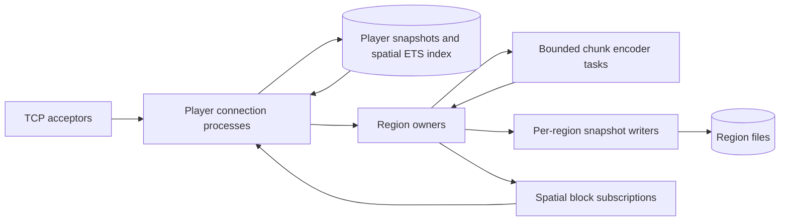

# Ownership, concurrency and consistency

The BEAM is useful here because many players, sockets, regions and background jobs can progress independently. Actor ownership defines where mutations are serialized; it does not make shared gameplay rules automatically independent.

## Owners

| State | Owner | Access |
|---|---|---|
| Socket and protocol phase | Connection process | Sequential packet handling; bounded TCP input |
| Authoritative preview player state | Connection process | Actor-local state, published ETS snapshot |
| Admission, names, lifecycle | Players process | One call at admission/ready; monitors at exit |
| Spatial membership | Player process, cleanup by Players | Public ETS index; concurrent readers |
| Block overrides and chunk revisions | Region process | Ordered calls within that region |
| Encoded chunk cache | Region process | Immutable binaries shared with callers |
| Encoding computation | Supervised task | Immutable chunk snapshot and captured revision |
| Region file | Region's writer process | Serialized atomic snapshot replacement |
| Player pose file | Leased session writer | Validated fixed-size snapshot; UUID registration fences reconnects |
| Player menu inventory | Connection process | Sparse bounded 46-slot map, selected hotbar, cursor and 15-bit state ID |

The admission process is outside the movement and block hot paths. Spatial ETS holds published snapshots; reading another player's snapshot does not grant permission to mutate their state. Independent sessions and region owners are scheduled across available BEAM schedulers.

## Replication and pressure

Observers sample nearby player IDs from the spatial index every 50 ms, fetch one current snapshot at a time, compare compact quantized views, and batch changes into one socket write. These observations are eventually consistent. They are suitable for network replication; future collision and combat need region-authoritative simulation snapshots instead.

Moving entities therefore do not enqueue an event for every visible recipient. Dense visibility still requires roughly quadratic packet output: every player can see every other player. Concurrency cannot remove that protocol/bandwidth cost. Interest management limits the scope to nearby regions and the configured view radius.

Reliable block/chat/lifecycle messages retain a mailbox limit. Slow sockets have send timeouts. Clients acknowledge bounded chunk batches before receiving another batch. Packet parsing yields after 64 frames and rejects oversized frames, decompression overruns and excess packet/decoded-byte rates.

Chunk tasks are limited to the scheduler count. A region holds at most one encoding job for a requested chunk and combines its waiters. Edits increase a chunk revision and invalidate its cache. A result from an older revision is discarded and re-encoded. Tasks do not block the region owner while computing.

## Failure and storage

Connections are temporary supervised children; losing one does not recreate every connection. Region owners are recreated lazily after failure. The root supervisor restarts dependent children after an infrastructure owner dies; restarting the listener preserves existing socket owners.

Region writers are linked to their owners. Writers serialize snapshot replacement through a synchronized temporary file and rename. Periodic saves acknowledge their revision; newer edits retain the dirty flag. Graceful shutdown flushes dirty state. This is a snapshot store, not an Anvil implementation or a transaction log, and hard crashes may lose unsaved edits.

Player pose writers are temporary supervised children registered by UUID, with
mutual monitoring of the connection and writer. Disk reads occur after startup
so a slow file cannot block the dynamic supervisor. A connection sends at most
one pending periodic checkpoint, with a five-second deadline, and flushes its
latest accepted pose on disconnect/graceful shutdown. Connections trap supervisor
shutdowns; writers remain alive until connection shutdown completes. Movement
still updates owner-local state and ETS without per-packet disk messages.

The UUID lease stays registered through writes and final close; a reconnect
racing a closing lease is rejected rather than creating a stale competing
writer. Files contain a version, UUID, XYZ, yaw/pitch and SHA-256 checksum in 88
bytes. Loads read at most 89 bytes and validate length, identity, checksum and
preview bounds. Corrupt/unreadable files reject only that identity and remain
untouched. Save errors/timeouts disconnect their owner and are logged; killed
connections and hard crashes can lose changes since the last checkpoint. This
format has no inventory, dimensions or vanilla NBT compatibility yet.

Player inventories are pure bounded structs inside their connection. Creative
slot writes, selected-hand lookup and hand swaps execute serially in that owner;
network snapshots publish accepted state. Startup sends all 46 menu slots.
Supported basic clicks mutate that owner; unsupported edits/interactions are
corrected from owner state. Predicted hashes are structurally decoded with bounds
and never accepted as inventory contents. State mismatch triggers correction;
it does not provide a second inventory authority. Aggregate encoded inventory
data is capped at 512 KiB, below the packet limit, including the cursor. Rejected
operations preserve the previous state. Empty slots remain sparse.
Slot storage is separate from region simulation and does not yet persist or
implement survival/menu transactions, drops or equipment replication.

## Survival consistency still to implement

Fixed 8×8-chunk ownership is sufficient for this independent-edit preview. Redstone, fluids, explosions, entity AI and collision involve neighboring state. They must use an explicit boundary protocol before parallel survival ticks are enabled.

The intended progression is deterministic region ticks over owned state, buffered boundary events assigned to a logical tick, and immutable neighbor snapshots. Entity transfer should use a monitored handoff with a transfer epoch, source fencing, destination acknowledgment and rollback; a connection process stays stable through that transfer. Operations requiring atomic writes across regions need a defined coordinator/order and failure recovery. These mechanisms currently remain design work.

Region ticks have absolute deadlines and avoid an unbounded catch-up queue. There is currently no meaningful survival TPS benchmark because the simulation callbacks do not yet run survival mechanics.
