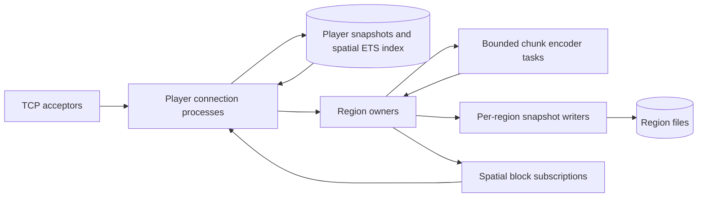

# Ownership, concurrency and consistency

The BEAM is useful here because many players, sockets, regions and background jobs can progress independently. Actor ownership defines where mutations are serialized; it does not make shared gameplay rules automatically independent.

## Owners

| State | Owner | Access |
|---|---|---|
| Socket and protocol phase | Connection process | Sequential packet handling; bounded TCP input |
| Authoritative preview player state | Connection process | Actor-local state, published ETS snapshot |
| Admission, names, lifecycle | Players process | One call at admission/ready; monitors at exit |
| Spatial membership | Player process, cleanup by Players | Public ETS index; concurrent readers |
| Block overrides and chunk revisions | Region process | Ordered calls within that region |
| Stationary development items | Region process | Bounded creation and stack/removal CAS; incarnation/revision plus writer acknowledgment |
| Item replication publications | Region-owned protected ETS table | Compact cached packet views; readers neither allocate regions nor call owners |
| Encoded chunk cache | Region process | Immutable binaries shared with callers |
| Encoding computation | Supervised task | Immutable chunk snapshot and captured revision |
| Region file | Region's writer process | Serialized atomic snapshot replacement |
| Player pose/inventory file | Leased session writer | Bounded checksummed snapshot; UUID registration fences reconnects |
| Player menu inventory | Connection process | Sparse bounded 46-slot map, selected hotbar, cursor and 15-bit state ID |

The admission process is outside the movement and block hot paths. Spatial ETS holds published snapshots; reading another player's snapshot does not grant permission to mutate their state. Independent sessions and region owners are scheduled across available BEAM schedulers.

## World clocks

One supervised owner holds game time, the two pinned core-pack clocks, the
advance-time control, shared Overworld weather and world difficulty/lock. It owns no region gameplay,
player inventory or entity mutation. Clock totals/fractions/rates use the native float32 tick boundaries;
paused clocks stop independently, and global advance-time stops both clocks while
game time continues. A fenced 50 ms timer advances one delivered game tick; lag
never becomes an unbounded catch-up queue or offline time advancement. Coupled
region simulation phases and their relationship to game time remain VMC-011 work.

Protected ETS holds one atomic publication with a current login packet and a
20-tick periodic packet/version. Connections read it concurrently during their
existing replication callback; controls publish a new version immediately. No
clock tick is sent to every session. The cached packet is an immutable binary.

A linked writer reads at most 257 bytes and validates the fixed registered-clock
schema, version/data version and checksum. The 113-byte current snapshot uses a
unique synchronized temporary file and atomic replacement. The ticking owner
admits only one immutable checkpoint, fences acknowledgments/deadlines and keeps
newer state dirty. An uncertain save stops/fences the owner and writer before
reload, without flushing older memory over the possible commit. Normal shutdown
flushes the latest state. These are custom preview files; vanilla saved-data NBT,
full gamerules/time markers, idle pause and data-pack clock changes remain work.
Versions 1 (clocks) and 2 (clocks/weather) load without losing existing values and
migrate to version 3 with difficulty/lock on save. Timers, flags, cycle control and the owned legacy
48-bit random stream persist; transient intensity reloads follow vanilla weather
preparation. Weather timers advance independently of the daylight control.
Disabling weather cycling freezes timers/flags while intensity still approaches
its targets. Observers reconcile shared views with at most five game events;
coalescing UI snapshots never skips authoritative weather ticks. Lightning,
snow/ice, biome precipitation and region environmental gameplay remain work.

Difficulty defaults to Easy/unlocked, matching the pinned dedicated server.
Trusted host controls respect the lock unless explicitly forced; changing the
lock and forced changes publish current state. Sessions read a cached packet
concurrently and emit it only when the observed level/lock changes, including at
login. Client administration is not authorized yet. Hardcore, regional difficulty
and difficulty-dependent damage/hunger/spawning effects remain separate work.

## Replication and pressure

Observers sample nearby player IDs from the spatial index every 50 ms, fetch one current snapshot at a time, compare compact quantized views, and batch changes into one socket write. These observations are eventually consistent. They are suitable for network replication; future collision and combat need region-authoritative simulation snapshots instead.

Moving entities therefore do not enqueue an event for every visible recipient. Dense visibility still requires roughly quadratic packet output: every player can see every other player. Concurrency cannot remove that protocol/bandwidth cost. Interest management limits the scope to nearby regions and the configured view radius.

Reliable block/chat/lifecycle messages retain a mailbox limit. Slow sockets have send timeouts. Clients acknowledge bounded chunk batches before receiving another batch. Packet parsing yields after 64 frames and rejects oversized frames, decompression overruns and excess packet/decoded-byte rates.

Chunk tasks are limited to the scheduler count. A region holds at most one encoding job for a requested chunk and combines its waiters. Edits increase a chunk revision and invalidate its cache. A result from an older revision is discarded and re-encoded. Tasks do not block the region owner while computing.

## Failure and storage

Connections are temporary supervised children; losing one does not recreate every connection. Region owners are recreated lazily after failure. The root supervisor restarts dependent children after an infrastructure owner dies; restarting the listener preserves existing socket owners.

Region writers are linked to their owners. Writers serialize snapshot replacement through a synchronized temporary file and rename. Periodic saves acknowledge their revision; newer edits retain the dirty flag. Graceful shutdown flushes dirty state. This is a snapshot store, not an Anvil implementation or a transaction log, and hard crashes may lose unsaved edits.

Player state writers are temporary supervised children registered by UUID, with
mutual monitoring of the connection and writer. Disk reads occur after startup
so a slow file cannot block the dynamic supervisor. A connection sends at most
one pending periodic checkpoint, with a five-second deadline, and flushes its
latest accepted pose/inventory on disconnect/graceful shutdown. Connections trap supervisor
shutdowns; writers remain alive until connection shutdown completes. Movement
still updates owner-local state and ETS without per-packet disk messages.

The UUID lease stays registered through writes and final close; a reconnect
racing a closing lease is rejected rather than creating a stale competing
writer. Versions 2/3 include UUID, XYZ, yaw/pitch, data version 5023, selected
hotbar, fixed-order supported slot/cursor stacks and SHA-256 checksum. A file is
at most 852,327 bytes; reading admits at most that limit + 1 before decoding.
The previous 88-byte version 1 pose is accepted read-only and migrates on the next
save. Corrupt/unreadable files reject only that identity and remain untouched.
Item serialization and file writes stay in the writer. Save errors/timeouts
disconnect their owner and are logged; killed connections/hard crashes can lose
state since the last checkpoint. Synced temporary-file replacement is not a
complete world transaction ledger or a parent-directory crash-durability guarantee. Dimensions,
full player state, data fixing and vanilla NBT compatibility remain future work.

Version 3 adds an unsigned 64-bit source sequence and zero/one outbox, bounded at
327,935 bytes: a pinned region and 1–5 stable-UUID supported item records. Inventory
encoding keeps its independent 512 KiB limit. Legacy snapshots recover sequence
zero/no outbox; no-sequence/no-outbox saves retain version 2. Source identity,
sequence and canonical digest derive from the player file and immutable request.
Source sequence never wraps and remains after the outbox is cleared.

`PlayerStore.open` returns a session fence. Periodic checkpoints/final close must
carry it; the writer owns journal fields and ignores supplied replacements for
them. Its trusted asynchronous prepare API validates before/after inventories and
component-aware conservation (before = after + batch), then syncs/replaces the
reduced inventory and intent in one file. Only after that write does it return
the new fence/snapshot. While an outbox exists, normal checkpoints/close cannot
roll inventory back. Preparation and completion rotate the fence, so older
snapshots stay invalid even after completion. Stale/pending close releases the
lease without writing. Transfer write errors stop the writer with an uncertain
outcome; recovery reloads the actual file, never an old rollback snapshot.

Completion queries the destination's authoritative owner-fenced receipt and
requires the exact region/source sequence/digest plus persistent item storage.
A missing/conflicting/unavailable or ephemeral receipt cannot clear an outbox.
Clearing preserves the depleted inventory and sequence. Owner loss/reopen uses a
fresh fence. Nil source storage rejects durable transfer preparation. Source API
requests are not exposed to clients; future session orchestration must bound
pending requests and hold inventory mutation until acknowledged.

`prepare_creative_drop` is a distinct trusted leased-owner API for one nonempty
record. It requires live infinite-material permission and retains the entire
inventory while journaling the authorized creation with the same sequence/outbox.
It has the same persistent-source/pending/fence and receipt-proof guards; there
is no general conservation bypass. Saved privileges still reset on decode, and
automatic login recovery delivers the already authorized intent without minting
again. Connected negative-slot packets now use it with a bounded FIFO for paired
creative commands: at most 160 commands/512 KiB including encoded payload and
fixed entry costs, 64 executions per callback and one scheduled continuation. The next
creation starts only after the prior outbox clears. Following slot writes retain
arrival order; independent writes remain immediate during immutable normal saves.
The pure connection counter charges 20 below 1480 and lazily decays one per 50 ms
preview tick, including empty requests. It needs an authoritative simulation tick
clock when that exists. Queue admission is deferred, unacknowledged input; it is
not persisted and stops at disconnect. Accepted edits follow existing preview
checkpoint/final-close durability. Old snapshots/intermediate slot acknowledgments
are suppressed during queued creative work so accepted client predictions remain
responsive; the final result publishes when idle. Actual creative Q/held Ctrl+Q,
stalled bursts and recovery pass. Other mouse gestures remain separate gates.

Login now retains the UUID lease while automatically reconciling a pending
outbox. Destination calls run in `TransferWorkers`, bounded at four times the
online scheduler count, separate from CPU preparation. Each session owns at most
one job, one retry timer and one ten-second overall deadline. Busy/restarting/
capacity outcomes and uncertain worker loss retry the same pinned UUIDs/sequence
with 50–500 ms backoff, at most twenty retries. Saturation never queues a job.
Results carry worker/token/monitor fences; retry/deadline messages are fenced too.
An ephemeral destination rejects before delivery, and conflicting/stale intents
cannot clear the source. A successful delivery requests source clear through the
leased writer; only its matching completion starts compressed login/configuration
and publishes depleted inventory with session-derived creative permission.
Socket callbacks perform no destination I/O. Unrelated sessions remain responsive.
Failure/disconnect/deadline cancels jobs/timers and preserves the actual source;
destination commit can still be uncertain and a later login deduplicates it.
Connected Q/Ctrl+Q now starts the same loop with an asynchronous source prepare.
One pinned selected-stack plan freezes inventory mutations until prepare,
delivery and clear finish. Counts publish only after source prepare; periodic
saves skip active transfers. A pending normal checkpoint rejects/corrects a new
drop. Selection, swaps, creative writes, clicks, close and placement are parsed
and corrected while frozen; movement/chat/keepalive continue. Completion retains
the latest pose and advances the current menu ID rather than restoring an old
snapshot ID. Source failures with no commit restore old counts; uncertain commits
disconnect into journal recovery. These drops use stationary preview entities;
vanilla physics/pickups and menu/creative/disconnect drops remain incomplete.

Ordinary menu clicks now produce an owner-local inventory plus zero/one drop
effects. No-effect plans publish immediately; effectful THROW/outside cursor
plans enter that same source prepare/delivery/clear path. A carried stack blocks
slot THROW and active quick-craft consumes an interrupting drop solely to reset
the gesture. The current normal menu never replenishes a crafting result; recipe
output loops, actual creative-input validation and disconnect cleanup
remain separate work. Required actual menu mouse input is still a validation gate.

Connected menu close now routes its overflowing return plan through the same
journal. Cursor then grid cleanup yields up to five pinned item records; partial
inventory merges commit with the complete outbox before publication. One region
batch/receipt commits all remainders. Capacity failure retains the intent rather
than publishing a prefix or rolling back counts. Busy normal saves and no-commit
source rejection retain the original cursor/grid/slots for a fresh close attempt.
This does not implement disconnected/removed-player disposition or item physics.

Player inventories are pure bounded structs inside their connection. Creative
slot writes, selected-hand lookup and hand swaps execute serially in that owner;
network snapshots publish accepted state. Startup sends all 46 menu slots.
Supported basic clicks mutate that owner; unsupported edits/interactions are
corrected from owner state. Predicted hashes are structurally decoded with bounds
and never accepted as inventory contents. State mismatch triggers correction;
it does not provide a second inventory authority. Aggregate encoded inventory
data is capped at 512 KiB, below the packet limit, including the cursor. Rejected
operations preserve the previous state. Empty slots remain sparse.
Slot storage is separate from region simulation. Supported slots/selection/cursor
now persist with pose; permissions, gestures and menu state IDs reset on login.
Virtual result 0 must remain empty and is never saved as a real item. Carried/grid
retention is preview recovery, not vanilla disconnect/menu lifecycle behavior.
Survival/menu transactions, drops and peer equipment replication remain incomplete.

Item entity packet primitives use immutable versioned type/serializer/accessor
facts and bounded pure encoders, including the current packed velocity format.
Metadata batches admit at most three supported fields and removals at most 4096 IDs.
Each region also owns at most 256 stationary development items with
512 KiB of cached logical packet bytes. Their mutation handles include the region
incarnation and item revision. CAS rejects stale updates/removals, and replacement
owners have new incarnations. There is no global entity mutation coordinator or
process per item. Owner loss destroys its protected ETS publication. With world
storage enabled, a replacement reads committed UUIDs/positions/stacks and rebuilds
fresh runtime IDs, cached packets and incarnation/revision handles. Nil storage
retains ephemeral behavior. IDs are reallocated rather than persisted; numeric IDs
may coincide across separate VM lifetimes. UUIDs provide persistent identity.

Item writes use the existing linked region writer and a separate checksummed
`r.X.Z.items` file (versions 1/2, data version 5023), at most 753,721 bytes. Version
1 contains items only; version 2 adds bounded retry receipts. Reads admit
at most that limit + 1 before parsing at most 256 records. Malformed records,
duplicate UUIDs, wrong region/coordinates, unsupported/empty stacks, versions and
checksums reject that region's load without overwriting its file. These are custom
preview records, not vanilla entity NBT, data fixing or complete item state.

A live region retains one immutable pending item proposal while the writer
serializes/syncs/replaces the file. It continues handling block operations and
ticks; further item mutations return busy. Publication/reply requires the matching
writer/token acknowledgment. No-op replacement avoids disk work. Error, writer
loss, a five-second deadline or shutdown before delivery of an acknowledgment can
leave an uncertain commit outcome. The owner is fenced/stopped and the actual
file is reloaded; it never writes an older item snapshot over a possible commit.
Block snapshots cannot overwrite item files. UUID lookup obtains a fresh current
handle. Synced replacement does not guarantee parent-directory/power-loss
durability or an inventory/world transaction. The ordinary scene create API still
has an uncertain retry outcome.

The internal item inbox admits 1–5 stable-UUID records and one positive unsigned
64-bit sequence from a trusted source UUID. A separate supervised `ItemWorkers`
pool, bounded by scheduler count, prepares pure plans from immutable owner state.
Each region retains one planning/writing operation with a shared five-second
deadline. Worker saturation rejects rather than queues. Worker/token/monitor
fencing discards stale results; no disk proposal exists until planning succeeds.
The owner continues ticks and block operations while preparation/storage runs.

Each region retains at most 4096 source sequence/digest receipts. Equal sequence
and canonical digest acknowledges an exact retry without disk work or entity
recreation. Conflicting equal sequences and older sequences reject. A new batch
and its advancing receipt commit in one item file replacement; removal/replacement
keeps the receipt. The file admits at most 524,288 bytes of item payload and 4096
fixed 56-byte receipts. Version 1 loads with an empty receipt map and is retained
for no-receipt scene writes. Nil storage retains ephemeral in-memory behavior.

This destination contract assumes a durable leased source that admits only one
outbox, pins UUIDs/destination/sequence, and finishes recovery before advancing.
The source outbox/fencing, automatic login recovery and connected keyboard-drop
integration are implemented. Clients cannot invoke the inbox directly. Source receipts are
never evicted merely to make room. Safe source retirement and coordinated backup
restoration require further fencing; source-cap exhaustion is an explicit rejection.

Observers sample publications in up to 64 subscribed regions and already-sent
chunks, retaining at most 1024 item identities/revisions. Each 50 ms interval
removes stale views first, then emits at most 64 additions/updates and 256 KiB of
logical item packet bytes. Socket framing/compression overhead is additional.
Round-robin scanning prevents continually changing low IDs from starving later
changes. Spawn precedes metadata; accepted state is cached as shared immutable
binaries. Pending changes stay in owner snapshots, rather than a connection
packet queue. Chunk-square interest filtering and hard visibility caps are preview
policies, not vanilla tracking-distance parity.

This scene API does not consume inventory. Zero velocity/no gravity keep its
scope independent of tick physics and region transfers. Creation timeout is an
uncertain outcome and must not trigger a blind retry. Complete entity persistence,
a complete recoverable transfer ledger, inventory ownership, merging, pickup, despawn,
collision and cross-region movement remain required gameplay foundations.

## Survival consistency still to implement

Fixed 8×8-chunk ownership is sufficient for this independent-edit preview. Redstone, fluids, explosions, entity AI and collision involve neighboring state. They must use an explicit boundary protocol before parallel survival ticks are enabled.

The intended progression is deterministic region ticks over owned state, buffered boundary events assigned to a logical tick, and immutable neighbor snapshots. Entity transfer should use a monitored handoff with a transfer epoch, source fencing, destination acknowledgment and rollback; a connection process stays stable through that transfer. Operations requiring atomic writes across regions need a defined coordinator/order and failure recovery. These mechanisms currently remain design work.

Region ticks have absolute deadlines and avoid an unbounded catch-up queue. There is currently no meaningful survival TPS benchmark because the simulation callbacks do not yet run survival mechanics.
